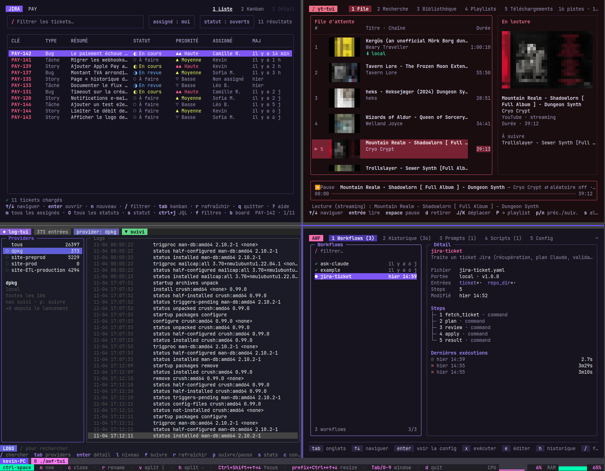

# wtui

A small terminal multiplexer with a tmux-like workflow: windows, split panes, mouse support,
scrollback, text selection and live CPU/RAM graphs. Written in Go.



The interface is available in **English** and **French**.

## Features

- Multiple windows (tabs) and nested horizontal/vertical splits
- Prefix-key driven (default `Ctrl+A`), plus direct focus switching with `Ctrl+Shift+arrows`
- Mouse: click to focus, wheel to scroll, drag to select and copy
- Optional separator lines between panes (`--borders`)
- The terminal window title follows the active pane, as `title - wtui` (restored on exit where supported)
- CPU / RAM sparklines in the status bar (Linux only, hidden on narrow terminals)
- Interface language auto-detected from the environment, or set with `--lang`

## Install

### One-liner (Linux and macOS, amd64/arm64)

```sh
curl -fsSL https://raw.githubusercontent.com/boutdecode/wtui/main/install.sh | bash
```

Options (environment variables):

| Variable            | Description                                                      |
|---------------------|------------------------------------------------------------------|
| `WTUI_VERSION`      | Version to install, e.g. `v0.1.0` (default: latest release)      |
| `WTUI_INSTALL_DIR`  | Target directory (default: `/usr/local/bin`, else `~/.local/bin`) |

### From source

Requires Go 1.24 or newer.

```sh
git clone https://github.com/boutdecode/wtui.git
cd wtui
go build -o wtui ./cmd/wtui
```

## Usage

```
wtui [--prefix KEY] [--borders] [--cwd DIR] [--lang en|fr] [command [args...]]
```

| Flag                       | Environment    | Description                                                   |
|----------------------------|----------------|---------------------------------------------------------------|
| `--prefix KEY`             | `WTUI_PREFIX`  | Prefix key: `ctrl-a` (default), `ctrl-b`, `ctrl-space`, `ctrl-\` |
| `--borders`                | `WTUI_BORDERS=1` | Draw separator lines between panes                          |
| `--cwd DIR`, `--working-directory DIR` | `WTUI_CWD` | Directory of the first pane                    |
| `--lang en\|fr`            | `WTUI_LANG`    | Interface language (default: from `LC_ALL`, `LC_MESSAGES`, `LANG`) |
| `--version`                |                | Print the version                                             |

`command` is started in every new pane (default: `$SHELL`).

## Key bindings

Press the prefix key, then:

| Key                         | Action                                   |
|-----------------------------|------------------------------------------|
| `n`                         | New window                               |
| `c`                         | Close the active pane                    |
| `r`                         | Rename the window                        |
| `v` / `h`                   | Split vertically (`\|`) / horizontally (`-`) |
| `Shift+arrows`              | Swap the active pane with its neighbour  |
| `Ctrl+arrows`               | Resize the active pane                   |
| `Tab` / `0`-`9`             | Switch window                            |
| `d`                         | Quit                                     |

Without the prefix: `Ctrl+Shift+arrows` moves focus between panes.

Mouse: click focuses a pane, the wheel scrolls the history, dragging selects and copies text.

## Platform notes

Linux and macOS are supported. The CPU/RAM graphs rely on `/proc` and are only shown on Linux.

## Development

```sh
go vet ./...
go test ./...
```

Releases are built by GitHub Actions when a `v*` tag is pushed:

```sh
git tag v0.1.0 && git push origin v0.1.0
```

Translations live in `internal/i18n/i18n.go`; add a language by adding a catalogue and a case in `Normalize`.
